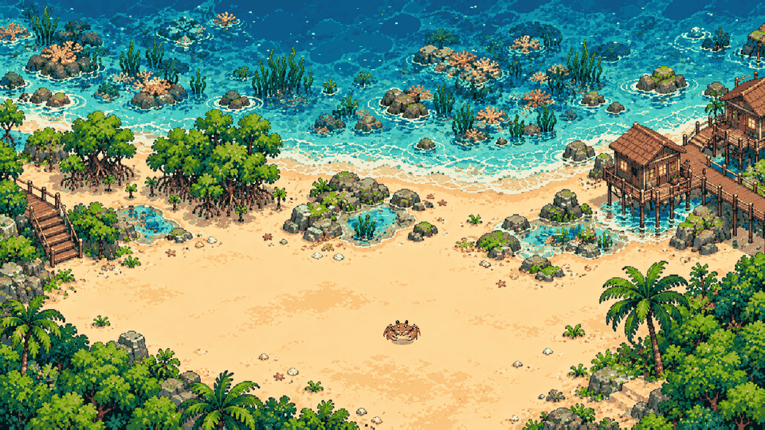
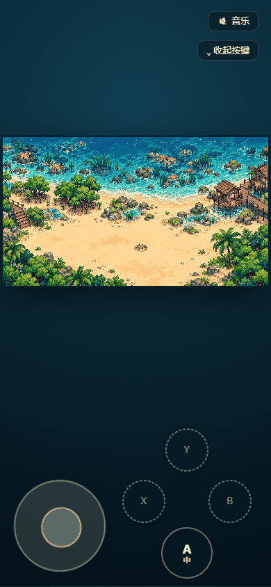

# 深圳海岸小世界 · 红树林与螃蟹

一个本地运行的 2.5D 像素小场景：固定不滚动的深圳海岸（海水、沙滩、海藻床、红树林、珊瑚礁、台阶、高脚屋），
加一只可以四向走动的螃蟹——键盘（WASD / 方向键）或**手机触屏（左摇杆 + 右 ABXY）**都能玩，
走路是 4 组连续帧循环，角色有大 / 中 / 小三档尺寸可切。



手机上长这样（左下摇杆、右下 ABXY，`A` 键面上显示当前形状）：



> 想加新角色 / 换新场景？完整方法、参数与踩坑记录都在 **[ASSET-PIPELINE.md](ASSET-PIPELINE.md)**（永久备份，照着做即可复用）。

## 在线试玩

直接打开就能玩（无需安装）：

**https://starchen-cycler.github.io/crab-coast/**

> 浏览器自动播放策略：第一次按方向键或点一下页面后才会出声（背景音乐）。

## 操作

### 键盘 / 鼠标

| 键 | 作用 |
| --- | --- |
| `W` `A` `S` `D` / `↑` `←` `↓` `→` | 四向移动 |
| `T` | 切换角色尺寸（大 96 → 中 48 → 小 24，到两端反弹） |
| `M` | 静音 / 恢复背景音乐 |

左上角「尺寸」按钮与右上角「音乐」按钮也能做同样的事。
（触屏设备上左上角「尺寸」按钮会隐藏——右下角 `A` 键已经负责换形状，键面还显示当前是大/中/小。）

### 触屏

触屏控件在**检测到触屏设备时自动出现**（`matchMedia('(pointer: coarse)')` 或存在 touch 事件），
桌面不会看到；想在桌面上预览可用 `index.html?touch=1`。

| 控件 | 位置 | 作用 |
| --- | --- | --- |
| 半透明摇杆 | 左下 | 按住拖动，按主导轴四向移动（不做斜向，与键盘一致）；松手立即停 |
| `A` | 右下 | **形状轮询**，等同键盘 `T`（大 96 ↔ 中 48 ↔ 小 24，到两端反弹）；键面下方实时显示当前是大 / 中 / 小 |
| `B` `X` `Y` | 右下 | 占位键，虚线描边、点了没反应，留待接新功能 |
| `⌄ 收起按键` / `☰ 显示按键` | 右上（音乐按钮下方） | 一键隐藏 / 恢复整套虚拟按键，方便看场景；只藏摇杆和 ABXY，开关自己留在原处可以再点回来 |

- 摇杆有 10px 死区，轻微误触不会让角色乱走；摇杆头最大位移 44px，手指拖出圆外也不会断。
- 收起虚拟按键时，正在拖动的摇杆会立即回正（不会让角色一直走），竖屏底部预留的「操作带」同时归零，
  场景自动回到整屏居中；再点一次就恢复。收起状态**不会被记住**，刷新后按键一定回来——
  免得下次打开看到一片空白以为坏了。
- 输入通道按设备能力自动选：有 `touch` 事件就用 `touchstart/touchmove/touchend`（iOS / Android 全支持），
  鼠标 / 触控笔走 Pointer Events；两者不会重复触发。
- 布局：**竖屏**底部留一条 236px 的「操作带」，场景在它上方的区域居中，避免画面贴着摇杆；
  **横屏**屏幕高度受限，控件改为半透明叠在场景左右下角（主流手游做法），矮屏（≤560px）还会整体缩一圈。
- 适配了 `safe-area-inset-*`，刘海 / 手势条不会压住控件。
- **手势**：全页面**双击不会放大**（`touch-action: manipulation` + 旧 iOS 的 JS 兜底），
  但**双指缩放是允许的**——想凑近看像素细节就捏合。拖摇杆、按 ABXY 时不会误触发页面缩放或平移。
  注意：放大后场景与按钮会一起放大，固定定位的控件可能被推出可视区，捏回去即可。
- 用 `?touch=1` 或真机进入后，键盘 `T`、`M` 依然可用（蓝牙键盘同样生效），`A` 键面会跟着同步。

### 手机上按键没反应？

加 `?diag=1` 再打开，左上角会显示诊断面板（走哪条通道、`__input` 是否就绪、
触屏能力检测值、当前方向/形状、最近几次事件）：

```
https://starchen-cycler.github.io/crab-coast/?diag=1
```

面板里 `input=MISSING` 或 `ev:` 一直是「(无事件)」，就说明事件根本没到达控件，
把这张截图发出来即可定位。

## 怎么运行

三种方式，任选其一（都不需要联网、不需要安装依赖）：

| 方式 | 操作 | 说明 |
| --- | --- | --- |
| 直接双击 | 双击 `index.html` | 纯静态，`file://` 下即可运行 |
| 本地服务器 | 双击 `serve.cmd` | 启动 `http://127.0.0.1:8099/` 并自动打开浏览器 |
| 手动 | `python -m http.server 8099` | 然后访问 `http://127.0.0.1:8099/` |

手机上想真机试：让手机和电脑同一个局域网，访问 `http://<电脑内网IP>:8099/`（用上面的本地服务器方式）。

## 怎么玩

- 四向移动，松开即停；同时按两个方向时以**最后按下**的为准，不会走出斜线。
- 螃蟹只会横着走：换方向时身体按圆弧旋转——转 90° 时身体跟着转 90°，同方向或掉头时身体朝向不变。
- 场景边缘与房屋、礁石、红树林是障碍，走不过去（可行走区域来自背景沙色的自动提取）。
- `M` 或右上角音乐按钮：开关背景音乐（状态记在 localStorage）。
- `T` 或 `A`：换角色尺寸，到最大 / 最小会掉头，不会绕回。

## 目录结构

```
crab-coast/
├── index.html                页面骨架（画布 + HUD + 加载提示 + 触屏控件挂载点）
├── main.js                   渲染、输入、朝向状态机、尺寸切换、探针
├── touch-controls.js         触屏控件：左摇杆 + 右 ABXY（仅触屏设备加载）
├── serve.cmd                 一键本地启动
├── requirements.md           需求台账（reqledger 生成，勿手改）
├── ASSET-PIPELINE.md         资产管线手册（提示词、抠图、切片、验收，可复用）
├── docs/
│   ├── gameplay.png          桌面端截图（README 首图）
│   └── touch_controls.png    手机端截图（摇杆 + ABXY）
├── assets/
│   ├── bg_base.png           960×540 固定背景（海水/沙滩/海藻床/红树林/珊瑚礁/台阶/高脚屋）
│   ├── crab_sheet.png        192×192 动作卡：4×4，单帧 48×48（默认「中」）
│   ├── crab_sheet_96.png     384×384 动作卡：单帧 96×96（「大」）
│   ├── crab_sheet_24.png     96×96 动作卡：单帧 24×24（「小」）
│   ├── kelp_strip.png        144×64 海藻摆动 3 帧
│   ├── scene.js / scene.json 场景元数据：帧布局、出生点、速度、可行走格、水面点
│   └── gpt/                  AI 母版与中间产物（scene_ref、crab_sheet_ref_v*、half_test/…）
├── music/
│   ├── seaside_lazy_loop_40s.wav  40 秒无缝循环 BGM（正在使用）
│   ├── seaside_lazy_loop_40s.mp3  同上，体积更小的备选
│   ├── bgm.js                播放器：首次交互起播 + M 键 + 静音记忆 + 淡入淡出
│   ├── README.md             音乐规格与替换方式
│   └── _replaced_20261028/   被替换掉的旧 BGM 与当时的生成脚本
├── tools/                    Python 资产管线 + 浏览器验收探针
│   ├── build_scene.py        背景量化、可行走格提取、场景数据生成
│   ├── slice_crab_v2.py      按固定画幅切动作卡（可指定输出尺寸）
│   ├── crab_24.py / crab_96_side.py / crab_side_scale.py  各尺寸微调
│   ├── check_sheet.py        动作卡一致性检查（尺寸/透明角/脚底锚点）
│   ├── probe_*.js            浏览器内探针（位移、边界、帧序、帧率、背景固定性）
│   ├── prompts/              当时实际发给图片模型的提示词（留档）
│   └── ledger_step*.py       把需求台账推进到已发布（提交→审核→基线→开发→验收→发布→变更）
└── evidence/                 验收截图、实测数据与对照说明
```

## 角色与背景是怎么来的

| 部分 | 来源 |
| --- | --- |
| 场景与螃蟹的**设计** | 图片生成模型产出的母版（`assets/gpt/scene_ref.png`、`crab_sheet_ref_v*.png`） |
| 背景**运行图** | 母版经 `tools/build_scene.py` 做 LANCZOS 缩放 → MEDIANCUT 调色板量化（无抖动）→ 硬色块 960×540 |
| 螃蟹**动作卡** | 母版色键抠绿（`G - max(R,B)`，软阈值去绿边）→ 按 4×4 网格切片 → 侧向行按行 90% 缩放压厚度 |
| 三档尺寸 | 同一套朝向与动画规则，分别生成 96 / 48 / 24 三种单帧；脚底锚点 `footLine` 保证换尺寸不悬空 |
| 可行走区域 | 从背景沙色反推：8px 一格 → 沙占比 ≥60% → 8 邻域腐蚀；1566 格可走 |
| 海浪 / 水面闪光 | 运行时用 Canvas 曲线与随机点实时绘制（点位来自 `scene.json`） |
| **背景音乐** | 由你提供并替换的 40 秒无缝循环（`music/seaside_lazy_loop_40s.wav`） |

没有直接裁切 AI 出的网格图，是因为同一张图里各格的比例与腿部姿态对不齐，切片后会抖。
所以最后落地的做法是：**用 AI 图定比例与配色，用代码近似出真正稳定的帧**。

## 背景音乐

海边悠闲向的电子/芯片音乐，40 秒无缝循环。播放器逻辑在 `music/bgm.js`：

- 首次按键 / 点击后起播（绕开浏览器自动播放限制），音量 0.42，切换时 320ms 淡入淡出；
- `M` 或右上角按钮静音，状态存 localStorage（`crab-coast:bgm-muted`）；
- 无缝靠取模写入：`idx = (start + arange(n)) % N`，接缝不会出现静默或爆音。

换成自己的曲子：替换 `music/seaside_lazy_loop_40s.wav`（保持循环长度一致即可），
或改 `index.html` 末尾的 `<script src="music/bgm.js"></script>` 指向别家播放器；不需要音乐就整行删掉。

## 技术规格

| 项 | 值 |
| --- | --- |
| 逻辑画布 | 960 × 540，等比缩放到窗口，最近邻放大 |
| 单帧尺寸 | 48 × 48（中，默认）/ 96 × 96（大）/ 24 × 24（小） |
| 动作卡 | 4 行（下 / 左 / 右 / 上）× 4 帧 = 16 帧 |
| 行走帧率 | 8 fps |
| 移动速度 | 110 px/s，按时间增量计算 |
| 可行走格 | 8px 一格，120 × 67 网格，1566 格可走 |
| 渲染 | `requestAnimationFrame`，`imageSmoothingEnabled = false`，`image-rendering: pixelated` |
| 触屏 | `touch-controls.js`，`pointer: coarse` 自动挂载，指针捕获 + 10px 死区 |

## 重新生成资产

```powershell
python tools/build_scene.py                 # 重建背景、可行走格与 scene.js / scene.json
python tools/slice_crab_v2.py               # 从母版切 48px 动作卡（可带源图与输出参数）
python tools/crab_96_side.py                # 生成 96px 版本
python tools/crab_24.py                     # 生成 24px 版本
python tools/check_sheet.py                 # 检查动作卡尺寸、透明角与脚底锚点
```

## 验收探针

页面暴露了几个调试接口，可在控制台或自动化脚本里直接验证行为：

```js
__probe.state()          // {x, y, dir, face, bodyDeg, heading, frame, size, moving, pressed}
__probe.press('KeyD'); __probe.release('KeyD');
__probe.setPos(500, 412) // 瞬移，测边界与碰撞用
__probe.fps(); __probe.longFrames()
__probe.canvasRect(); __probe.grid

__input.setTouchDir('right')   // 模拟摇杆
__input.touchDir               // 当前摇杆方向
__input.cycleShape()           // 等同按 A / T
__touch.visible; __touch.dir; __touch.shape   // 触屏 UI 状态
```

`evidence/` 下是一次完整验收跑出来的结果（截图 + 探针 JSON）。
